# 2024 빅콘테스트 | SKT OD·STAY 데이터를 활용한 전통시장 유형별 활성화 방안

## 프로젝트 요약

* **목표:** 시장마다 다른 이동·체류 수요와 주변 조건을 묶어, 유형에 맞는 활성화 방안을 제안
* **확인:** 830곳을 외곽형 204곳, 독립 근린형 255곳, 주거 귀가형 266곳, 쇼핑 밀집형 105곳으로 분류
* **제안:** 구룡포의 비장날 주말 시범 운영, 중마의 평일 오후·저녁 체류 공간, 신림의 평일 저녁 장보기, 국제시장권의 인접 시장 공동 안내

## 분석 배경과 질문

2024 빅콘테스트의 일환으로 전통시장별 수요와 주변 여건을 분석해 활성화 방안을 제안하였다. 시장 관련 자료가 여러 공공기관에 흩어져 있어 일관된 기준으로 비교하기 어려웠기 때문에, 제공된 SKT OD·STAY 데이터에 시장·주민 자료를 연결하였다. 이에 이동·체류 목적, 도착 시간, 접근성, 인근 시장과의 관계를 함께 살펴 **시장을 유형별로 묶고 각 유형에 맞는 운영·편의·홍보 방안을 제안했다.**

## 수행 내용과 역할

| 수행 작업 | 역할 |
|---|---|
| 자료 수집 | 시장 내부 설비·버스정류장·주차장·주변 대규모점포 자료 수집 |
| 분석 테이블 통합 (공동) | 전통시장과 행정동 코드를 연결하고, 각자 수집한 자료를 시장 분석 테이블에 순차 통합 |
| 지표 산출 | OD·주민 연령 구성·배후지 코사인 유사도 계산  |
| 사례 해석 | 신림의 이동·주민 구성 분석과 활성화 방안 검토 |
| 유형 분류 | OD·STAY, 메타 데이터, 접근성 지수, 배후지, 인근 시장 관계를 활용해 K-Means로 외곽·도심을 구분하고, 도심형에 아키타입 분석을 적용 |

* **팀 구성:** 2인 팀
* **공모전 수행:** 2024년 6~7월

## 데이터 및 기술 스택

* **이동·체류:** SKT 자료 제공
  * OD: 출발·도착 행정동, 목적·연령·시간·이동수단
  * STAY: 행정동별 시간대·연령·목적별 체류 인원
* **시장·주변 시설:** 소상공인시장진흥공단 전통시장 현황·점포·상인·서비스 자료, 전국전통시장표준데이터, 공영주차장·버스정류장·도시철도역·대규모점포 위치 등
* **인구·공간:** 행정안전부 주민등록인구, 행정동 코드·경계와 중심점 등
* **기술 스택:** Python(pandas·NumPy·GeoPandas·scikit-learn·SciPy) · Matplotlib · 카카오 로컬 API

## 유형 분류와 대표 선정

* **관측 기간:** 
  * 2023년 9월 1일~10월 15일
  * 추석 연휴·한글날 등 연휴·공휴일을 제외한 일반일 38일(평일 26일·주말 12일)
* **비교 기준:** 
  * 전국 평균: OD 값이 있는 시장 830개 행의 평균. 
  * 출발지 거리처럼 결측이 존재하는 경우 결측치를 제외한 후 평균 계산.
* **입력:** 
  * OD·STAY, 시장 정보, OD 가중 접근시간, 배후지, Huff 기반 인근 시장 관계를 5개의 변수 카테고리로 구성
  * 5개의 변수 카테고리를 각각 PCA로 요약하고 총 30개의 주성분을 K-Means에 입력.
* **유형 분류:** 
  * K-Means 적용 결과 전통시장을 외곽형 204곳·도심형 626곳으로 구분. 
  * 도심형에서는 특성의 원형(아키타입) 3개를 찾고, 시장마다 가중치가 가장 큰 원형의 유형에 배정
  * K = 2 실루엣 계수 0.285
* **대표 선정:** 
  * 유형 신호와 사례별 이동·시설 조건을 함께 확인해 구룡포·중마·신림·국제시장권을 제안 사례로 선정

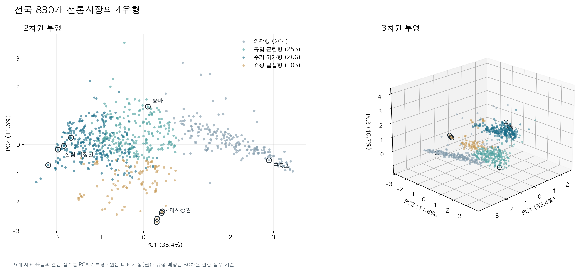

* **그림 해석:** 30개의 주성분을 2차원(누적 분산 비율 47.0%)·3차원(57.7%)으로 줄여 시장 위치를 표시
* **유형 판정:** 그림의 좌표가 아닌 30개 주성분으로 분류

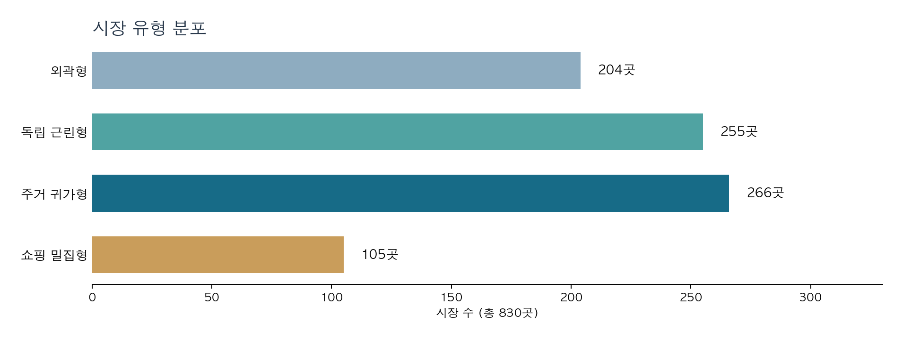

| 유형 | 시장 수 | 대표적인 특징 | 대표 사례 |
|---|---:|---|---|
| 외곽형 | 204 | 여행 목적 유입과 고령층 체류가 많고, 접근시간이 긴 편 | 구룡포시장 |
| 독립 근린형 | 255 | 가까운 지역의 쇼핑 이동이 두드러지고, 배후지 후보는 적은 편 | 중마시장 |
| 주거 귀가형 | 266 | 귀가 목적 이동이 많고, 전체 도착 중 20시 이후 비중이 높은 편 | 신림 시장권 |
| 쇼핑 밀집형 | 105 | 쇼핑 목적 이동·체류가 많고, 주변에 시장이 밀집 | 국제시장권 |

* **표 읽기:** 유형별로 두드러진 경향을 요약한 것으로, 같은 유형의 모든 시장이 이 특징을 똑같이 보이는 것은 아님.
* **유형명:** 여러 지표로 시장을 분류한 뒤 이동·체류와 주변 조건을 살펴 붙인 이름. OD·STAY는 시장 방문 기록이 아닌 행정동 단위 관측값이며, 목적별 STAY 비율은 분류 후 유형을 해석할 때 확인함.

## 활성화 방안

* **국제시장권:** 제안 대상은 8개 시장이고, 이동·체류 수치는 그중 4곳이 함께 있는 광복동 값.
* **신림 시장권:** 신림 일대의 관악신사시장(신사동)·관악종합시장(신원동)·신림현대종합상가(서림동)·우림시장(난곡동)을 묶은 사례. 네 시장이 있는 동의 값을 각각 씀.
* OD와 STAY는 같은 사람의 방문·체류를 연결한 자료가 아님. 네 제안은 시행하지 않은 시범 제안이며, 실제 방문·구매와 제안 수요는 확인되지 않음.
* OD에는 같은 행정동 안 이동이 포함되지 않아, 걸어서 장 보는 주민은 빠질 수 있음.
* **전국 비교값:** 시장 830행의 평균이며, 해당 값이 없는 시장은 제외
* **시간·요일 그림:** 시간별 %는 평일·주말 각각의 관측 시간 합계 기준. 요일별 %는 각 요일의 일평균을 합쳐 100%로 환산한 값이며, 요일별 관측일 수는 4~6일로 다름. 쇼핑여가 곡선은 관측된 시간만 표시

### 외곽형 · 구룡포시장

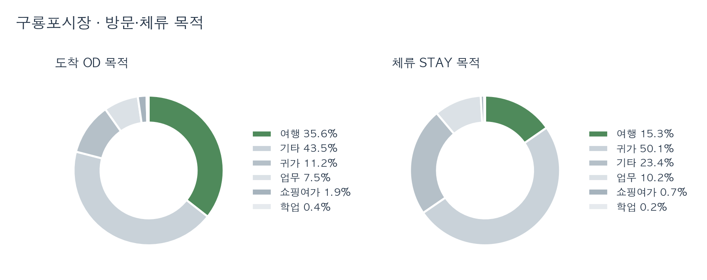

* **방문·체류 목적:** 도착의 35.6%, 체류의 15.3%가 여행 목적(전국 8.2%, 5.5%)

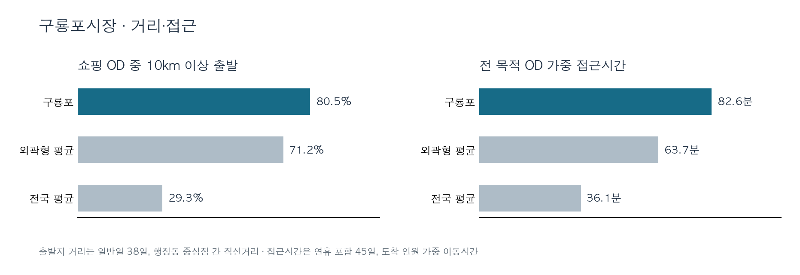

* **거리·접근:** 쇼핑 OD의 80.5%가 10km 이상에서 출발하고, 전 목적 OD 가중 접근시간은 연휴 포함 45일 집계로 82.6분으로 여행·원거리 이동이 두드러짐

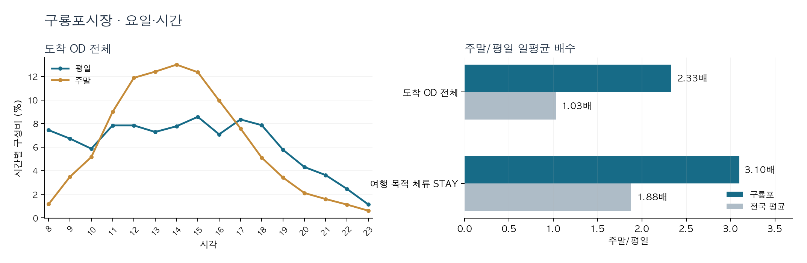

* **요일·시간:** 주말 일평균 도착은 평일의 2.33배(전국 1.03배), 여행 목적 체류는 3.10배(전국 1.88배), 주말 도착의 68.6%가 11~16시에 집중(전국 47.2%)
* **시장 특성:** 매월 3·8일 장이 서며, 전국전통시장표준데이터에는 상설장 겸용으로 등재. 관측 주말 12일 중 9일은 비장날이며, 장이 없는 날끼리 비교해도 주말 일평균 도착은 평일의 2.28배, 주말 도착 중 11~16시 비중은 67.7%여서 장날만으로 설명되지 않음
* **활성화 방안:** 비장날 주말에 문 여는 상설 점포를 먼저 확인한 뒤 11~16시 여행객 대상 운영을 시범 검토. 이 시간대 영업 점포 수와 점포 매출로 판정

장날 구분

* 일평균 도착은 평일 장날 5,147건·비장날 4,697건, 주말 장날 12,304건·비장날 10,715건. 장날이 7일뿐이라 장날 효과는 판정하지 않음

### 독립 근린형 · 중마시장

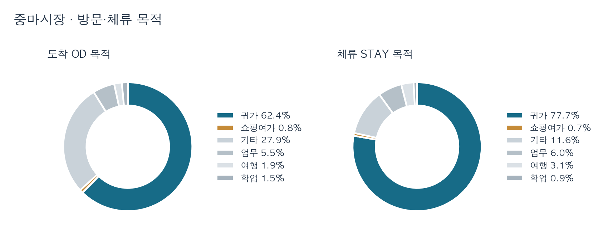

* **방문·체류 목적:** 귀가가 도착의 62.4%, 체류의 77.7%(전국 55.7%, 65.0%). 쇼핑여가는 0.8%, 0.7%(전국 5.9%, 3.7%)로 규모가 작음

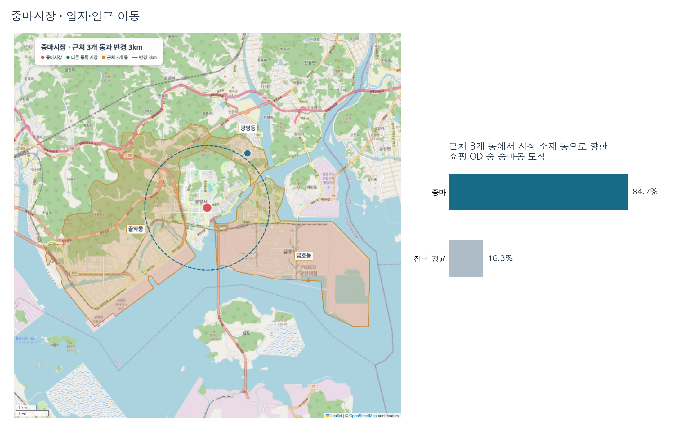

* **거리·접근:** 근처 3개 동(금호동·골약동·광영동)에서 출발한 쇼핑 OD의 84.7%가 중마동에 도착(전국 16.3%). 반경 3km 안에 다른 시장 없음(전국 평균 6.7곳)

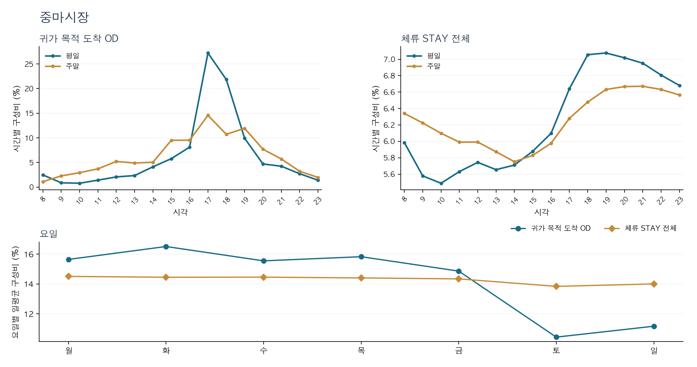

* **요일·시간:** 평일 쇼핑 도착의 63.1%가 14~16시에 집중(전국 30.4%). 쇼핑 체류는 평일 18·19시가 가장 높음(11.1%, 10.9%). 쇼핑 도착은 평일 일평균 123.1건, 주말 80.5건
* **활성화 방안:** 가까운 동네의 쇼핑이 중마동에 모이고 시장이 평일 23시까지 영업하므로, 평일 오후 장보기 손님이 저녁까지 머물도록 14~19시 먹거리·휴게 공간을 시범 운영. 시범 시간대 체류 시간(현장 조사)과 점포 매출로 판정

### 주거 귀가형 · 신림 시장권

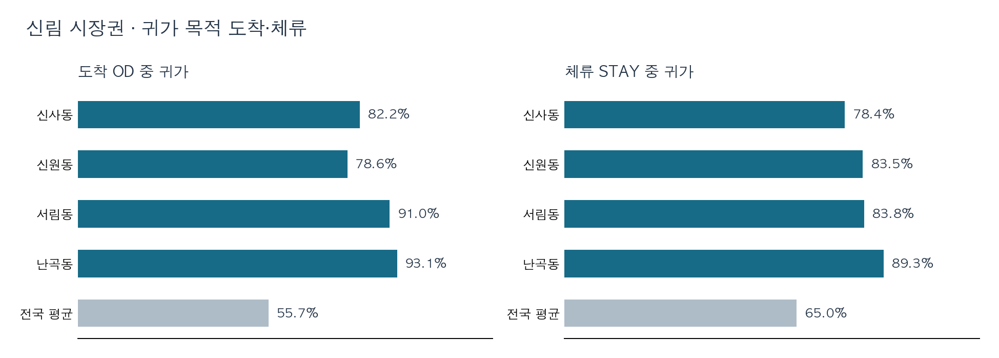

* **방문·체류 목적·연령:** 네 동 모두 귀가가 도착과 체류의 78% 이상(전국 55.7%, 65.0%). 체류 중 20·30대는 서림동만 47.0%이고 나머지 세 동은 30% 미만(전국 26.3%)이어서 대상을 특정 연령으로 좁히지 않음

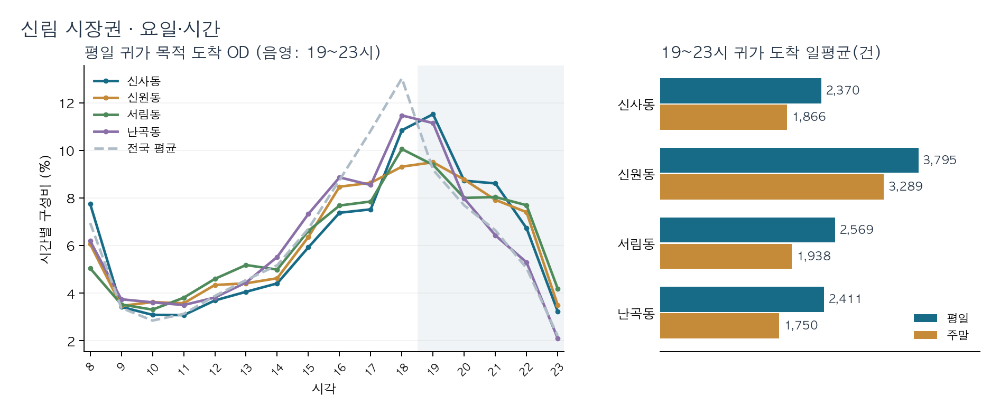

* **요일·시간:** 평일 귀가 도착 중 19~23시 비중은 네 동 모두 33.0% 이상(전국 30.8%)이고, 이 시간대 귀가 도착은 동마다 평일 하루 2,370건 이상으로 주말보다 많음
* **시장 특성:** 네 곳 모두 매일 여는 상설장(전국전통시장표준데이터)이며, 우림시장을 뺀 세 곳은 22시 또는 23시까지 영업함. 저녁 귀가는 신원동이 가장 많지만, 장보기 서비스 기록은 관악신사시장에만 있음
* **활성화 방안:** 평일 저녁 귀가 주민을 겨냥한 장보기 품목 판매를 신림 시장권에서 시범 검토. 관악신사시장부터 시작하고, 관악종합시장·신림현대종합상가로 넓힌 뒤 우림시장은 영업시간을 확인해 검토. 시범 시간대 구매 건수와 매출로 판정

네 시장 위치·여건과 해석 범위

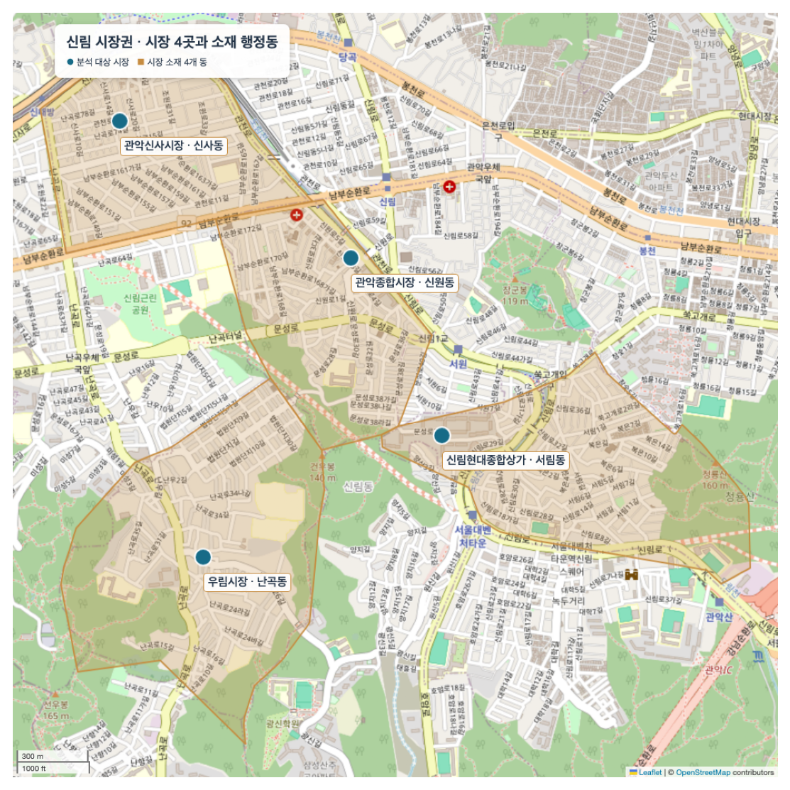

| 시장 (동) | 점포(2023) | 빈 점포 | 장보기 서비스(2021) | 평일 저녁 귀가 | 영업시간 |
|---|---:|---:|---|---:|---|
| 관악신사시장 (신사동) | 100 | 0 | 있음 | 2,370건 | 08:00~22:00 |
| 관악종합시장 (신원동) | 53 | 3 | 기록 없음 | 3,795건 | 09:00~23:00 |
| 신림현대종합상가 (서림동) | 89 | 15 | 기록 없음 | 2,569건 | 08:00~23:00, 점포별 자율 |
| 우림시장 (난곡동) | 17 | 0 | 기록 없음 | 2,411건 | 확인 안 됨 |

* **해석 범위:** OD·STAY는 시장이 있는 행정동 전체의 값. 귀가 도착과 체류가 시장 방문을 뜻하지 않으며, 귀가 이동의 출발지는 직전에 있던 곳임(거주지와 다름). 신원동에는 신원시장도 있어 동 값이 시장별로 나뉘지 않음

### 쇼핑 밀집형 · 국제시장권

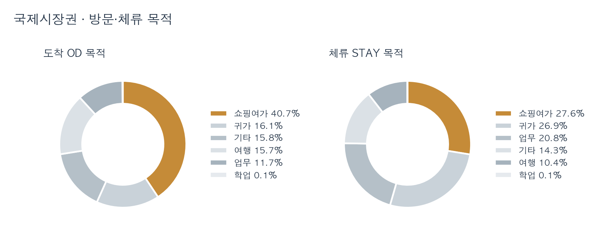

* **방문·체류 목적:** 쇼핑여가가 도착의 40.7%, 체류의 27.6%(전국 5.9%, 3.7%)

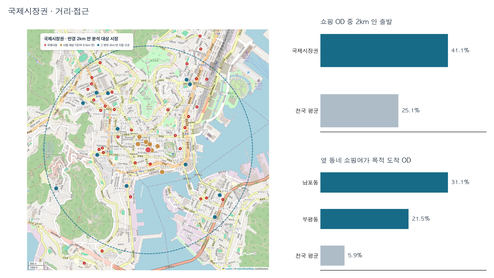

* **거리·접근:** 국제시장 반경 2km 안에 분석 대상 시장 19곳(전국 평균 3.9곳), 그중 7곳은 약 0.5km 안. 쇼핑 OD의 41.1%가 광복동 중심점에서 2km 안에서 출발(전국 25.1%). 옆 부평동·남포동의 쇼핑여가 목적 OD도 21.5%, 31.1%
* **활성화 방안:** 국제시장과 약 0.5km 안 7곳을 합친 8개 시장(광복동의 국제시장·만물의거리시장·신창상가·아리랑거리, 부평동의 부평깡통시장·창선상가·월드밸리, 남포동의 자갈치시장)을 대상으로 공동 지도·쿠폰과 시장 간 동선 안내를 시범 검토. 2개 시장 이상에서 쿠폰을 쓴 비율로 판정

## 적용 가능성

* **유형별 검토:** 같은 유형의 다른 시장에서는 해당 시장의 시간대·시설·상권 조건이 맞는지 먼저 확인한 뒤 시범 대상을 선정
* **시범 평가:** 운영 전후의 행정동 OD·STAY 자료만으로 시장 방문 효과를 판정하기 어려우므로, 사례별 판정 지표를 시범 구역에서 직접 수집

## 한계

* **관측 단위:** OD·STAY는 행정동 단위라 광복동 시장 4곳처럼 한 동을 공유하는 시장을 구분할 수 없고, 실제 입장·구매도 확인할 수 없음.
* **행정동 연결:** 830곳 중 191곳의 행정동 코드가 시장 좌표의 행정동과 다름. 연령·목적·규모 변수를 좌표 기준 값으로 바꿔 다시 분류하면 7곳의 유형이 바뀌고 대표 사례 4곳은 그대로임. 그 밖의 변수는 다시 계산하지 않아 유형 수치는 기존 연결 기준임.
* **유형 경계:** 
  * 5km Huff 기대점유가 없는 시장 121곳은 결측 표시와 중앙값 대입으로 처리. 
  * 대입 방식을 바꾸면 외곽형 수가 204곳에서 206곳으로 달라져 경계 시장의 유형은 신중히 해석해야 함.
* **관측 기간의 한계:** 이동·체류 비교는 연휴·공휴일을 제외한 일반일 38일 기준이며, 구룡포 접근시간은 연휴 포함 45일 집계임.
* **시장 개설 주기:** 상설·5일장 구분은 분류 입력에 없음. 대표 사례만 운영 형태를 따로 확인함.

## 코드와 자료

* SKT 원자료와 결합된 시장 특성표는 제공받은 자료를 포함해 공개하지 않음. 유형 분류 노트북은 해당 비공개 특성표를 입력받으며, 공개 자료만으로 수치 전체를 재계산할 수는 없음

* 실행 환경과 자료 범위는 [코드 안내](code/README.md) 참조.
