# 2024 빅콘테스트 | SKT OD·STAY 데이터를 활용한 전통시장 유형별 활성화 방안

## 프로젝트 요약

* **목표:** 시장마다 다른 이동·체류 수요와 주변 조건을 묶어, 유형에 맞는 활성화 방안을 제안
* **확인:** 830곳을 외곽형 204곳, 독립 근린형 255곳, 주거 귀가형 266곳, 쇼핑 밀집형 105곳으로 분류
* **제안:** 구룡포의 주말 운영·임시 주차, 중마의 저녁 주문 픽업, 신림의 귀가 시간대 야간 영업, 국제시장권의 인접 시장 공동 안내

## 분석 배경과 질문

2024 빅콘테스트의 일환으로 전통시장별 수요와 주변 여건을 분석해 활성화 방안을 제안하였다. 시장 관련 자료가 여러 공공기관에 흩어져 있어 일관된 기준으로 비교하기 어려웠기 때문에, 제공된 SKT OD·STAY 데이터에 시장·주민 자료를 연결하였다. 이에 이동·체류 목적, 도착 시간, 접근성, 인근 시장과의 관계를 함께 살펴 **시장을 유형별로 묶고 각 유형에 맞는 운영·편의·홍보 방안을 제안했다.**

## 수행 내용과 역할

| 수행 작업 | 역할 |
|---|---|
| 자료 수집 | 시장 내부 설비·버스정류장·주차장·주변 대규모점포 자료 수집 |
| 분석 테이블 통합 (공동) | 전통시장과 행정동 코드를 연결하고, 각자 수집한 자료를 시장 분석 테이블에 순차 통합 |
| 지표 산출 | OD·주민 연령 구성·배후지 코사인 유사도 계산  |
| 사례 해석 | 신림의 이동·주민 구성 분석과 활성화 방안 검토 |
| 유형 분류 | OD·STAY, 메타 데이터, 접근성 지수, 배후지, 인근 시장 관계를 활용해 K-Means로 외곽·도심을 구분하고, 도심형에 아키타입 분석을 적용 |

* **팀 구성:** 2인 팀
* **공모전 수행:** 2024년 6~7월

## 데이터 및 기술 스택

* **이동·체류:** SKT 자료 제공
  * OD: 출발·도착 행정동, 목적·연령·시간·이동수단
  * STAY: 행정동별 시간대·연령·목적별 체류 인원
* **시장·주변 시설:** 소상공인시장진흥공단 전통시장 현황·점포·상인·서비스 자료, 공영주차장·버스정류장·도시철도역·대규모점포 위치 등
* **인구·공간:** 행정안전부 주민등록인구, 행정동 코드·경계와 중심점 등
* **기술 스택:** Python(pandas·NumPy·GeoPandas·scikit-learn·SciPy) · Matplotlib · 카카오 로컬 API

## 유형 분류와 대표 선정

* **관측 기간:** 
  * 2023년 9월 1일~10월 15일
  * 추석 연휴·한글날 등 연휴·공휴일을 제외한 일반일 38일(평일 26일·주말 12일)
* **비교 기준:** 
  * 전국 평균: OD 값이 있는 시장 830개 행의 평균. 
  * 출발지 거리처럼 결측이 존재하는 경우 결측치를 제외한 후 평균 계산.
* **입력:** 
  * OD·STAY, 시장 정보, OD 가중 접근시간, 배후지, Huff 기반 인근 시장 관계를 5개의 변수 카테고리로 구성
  * 5개의 변수 카테고리를 각각 PCA로 요약하고 총 30개의 주성분을 K-Means에 입력.
* **유형 분류:** 
  * K-Means 적용 결과 전통시장을 외곽형 204곳·도심형 626곳으로 구분. 
  * 도심형에서는 특성의 원형(아키타입) 3개를 찾고, 시장마다 가중치가 가장 큰 원형의 유형에 배정
  * K = 2 실루엣 계수 0.285
* **대표 선정:** 
  * 유형 신호와 사례별 이동·시설 조건을 함께 확인해 구룡포·중마·신림·국제시장권을 제안 사례로 선정

* **그림 해석:** 30개의 주성분을 2차원(누적 분산 비율 47.0%)·3차원(57.7%)으로 줄여 시장 위치를 표시
* **유형 판정:** 그림의 좌표가 아닌 30개 주성분으로 분류

| 유형 | 시장 수 | 대표적인 특징 | 대표 사례 |
|---|---:|---|---|
| 외곽형 | 204 | 여행 목적 유입과 고령층 체류가 많고, 접근시간이 긴 편 | 구룡포시장 |
| 독립 근린형 | 255 | 가까운 지역의 쇼핑 이동이 두드러지고, 배후지 후보는 적은 편 | 중마시장 |
| 주거 귀가형 | 266 | 귀가 목적 이동이 많고, 주변에 배후지 후보가 있는 편 | 신림 시장권 |
| 쇼핑 밀집형 | 105 | 쇼핑 목적 이동·체류가 많고, 주변에 시장이 밀집 | 국제시장권 |

* **표 읽기:** 유형별로 두드러진 경향을 요약한 것으로, 같은 유형의 모든 시장이 이 특징을 똑같이 보이는 것은 아님.
* **유형명:** 여러 지표로 시장을 분류한 뒤 이동·체류와 주변 조건을 살펴 붙인 이름. OD·STAY는 시장 방문 기록이 아닌 행정동 단위 관측값이며, 목적별 STAY 비율은 분류 후 유형을 해석할 때 확인함.

## 활성화 방안

* 신림동과 광복동에는 각각 시장 4곳이 한 행정동을 공유. 
* 두 사례의 이동·체류 수치는 개별 시장이 아닌 **시장권** 기준. 
* OD와 STAY는 같은 사람의 방문·체류를 연결한 자료가 아님.

### 외곽형 · 구룡포시장

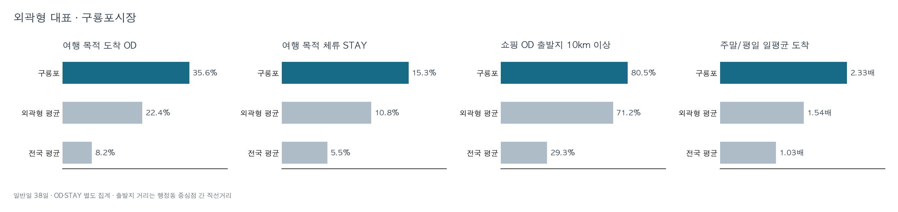

* **유입:** 여행 목적 OD 35.6%, 쇼핑 OD 중 10km 이상 출발 80.5%로 여행·원거리 이동이 두드러지는 시장권

* **체류·시간:** 여행 목적 STAY 15.3%, 주말 일평균 도착은 평일의 2.33배, 주말 도착의 68.6%가 11:00~16:59에 집중. 전체 목적 STAY도 주말에 많으며 주말 시간별 정점은 14시

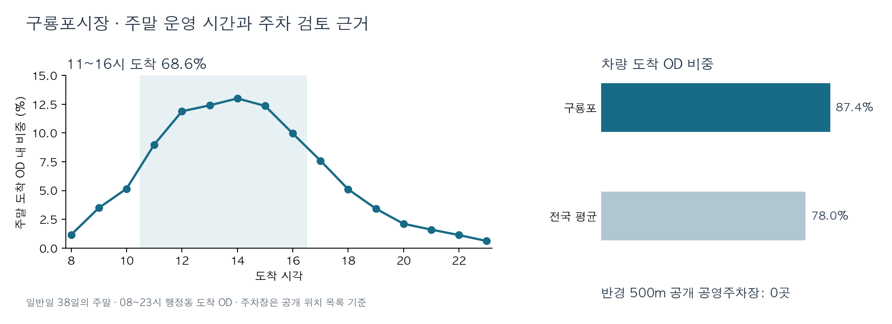

* **편의 조건:** 차량 OD 87.4%, 공개 공영주차장 목록에서 시장 반경 500m 안 주차장 미확인
* **활성화 방안:** 주말 11~16시 운영과 소포장·택배 발송 검토, 유휴 공공부지·관공서·학교의 주말 임시 주차 가능성은 현장 협의로 확인

비교 수치와 해석 범위

* **전국·유형 비교:** 여행 목적 OD는 외곽형 22.4%·전국 8.2%, 여행 목적 STAY는 외곽형 10.8%·전국 5.5%, 쇼핑 OD 중 10km 이상 출발은 외곽형 71.2%·전국 29.3%
* **시간·요일:** 첫 그림의 주말/평일 도착 비는 일평균 기준. 선 그래프의 시간별 OD·STAY는 평일·주말 각각의 구성비이며, 요일별 구성비는 각 요일의 일평균을 합쳐 100%로 환산한 값
* **제안 범위:** 소포장·배송 수요와 임시 주차 공간의 실제 사용 가능 여부는 확인되지 않아 시범 운영·현장 협의 대상으로 제시

### 독립 근린형 · 중마시장

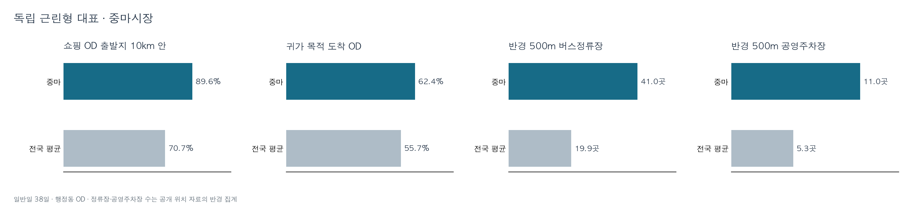

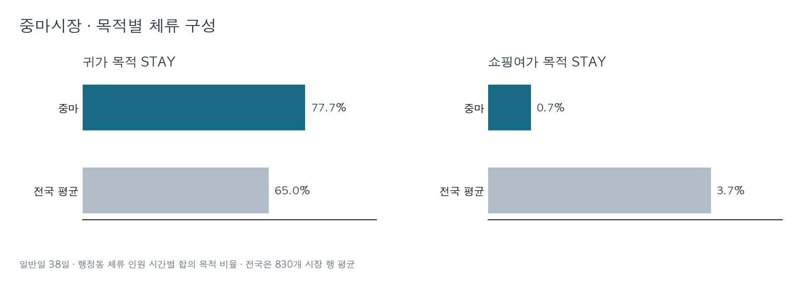

* **이동·체류:** 귀가 목적 OD 62.4%, 귀가 목적 STAY 77.7%로 귀가 흐름이 중심. 쇼핑여가 목적 OD 0.8%, STAY 0.7%로 쇼핑 수요 신호는 작음

* **시간·요일:** 평일 귀가 목적 도착은 17시가 정점, 전체 STAY는 19시가 정점. 귀가 목적 도착은 토·일보다 평일에 많음

* **출발·주변 조건:** 쇼핑 OD의 89.6%가 10km 안에서 출발, 3km 안 다른 등록 시장 없음, 500m 안 공영주차장 11곳·버스정류장 41곳
* **활성화 방안:** 귀가 동선에서 짧게 물품을 수령하는 방식을 소규모로 시험, 버스정류장·주차장과 가까운 수령 위치부터 확인

비교 수치와 해석 범위

* **전국 비교:** 쇼핑 OD의 10km 안 출발은 전국 70.7%, 귀가 목적 STAY는 전국 65.0%, 쇼핑여가 목적 STAY는 전국 3.7%, 반경 500m 안 공영주차장·버스정류장은 전국 평균 5.3곳·19.9곳
* **목적 구분:** 시간 그림은 귀가 목적 OD와 전체 목적 STAY를 보여주므로 두 곡선의 목적 범위가 다름
* **제안 범위:** OD와 STAY는 같은 사람의 이동·체류를 연결하지 않으며, 실제 시장 방문·구매 또는 주문 후 픽업 수요는 확인되지 않음

### 주거 귀가형 · 신림 시장권

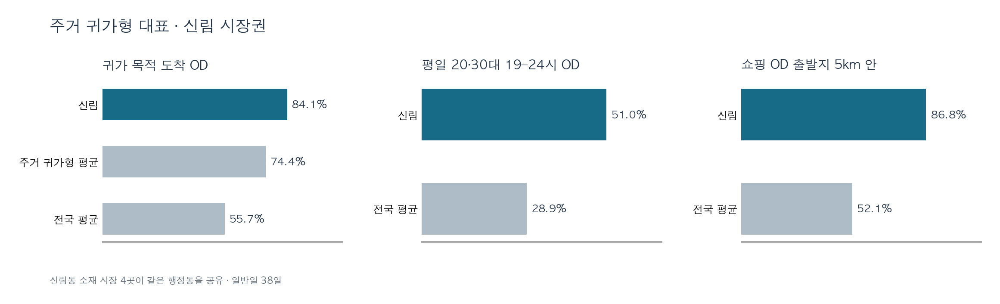

* **유입:** 귀가 목적 OD 84.1%, 평일 20·30대 도착의 51.0%가 19~23시에 관측

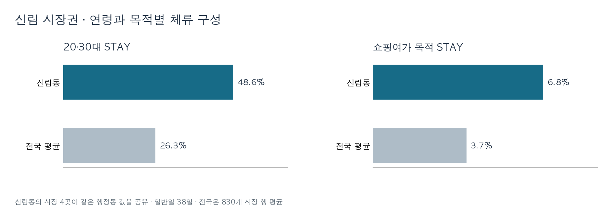

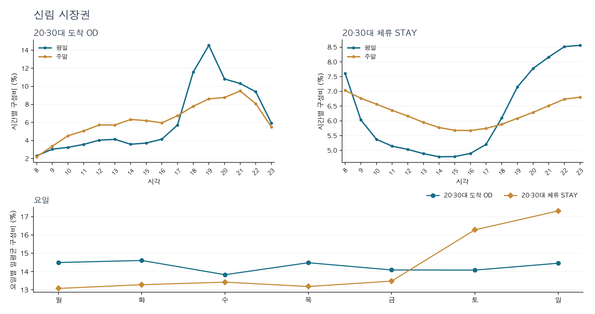

* **체류·요일:** 전체 STAY 중 20·30대 48.6%, 평일 20·30대 STAY의 40.2%가 19~23시에 관측. 같은 시간대 주말 비중은 OD 40.4%, STAY 32.4%로 평일보다 낮음

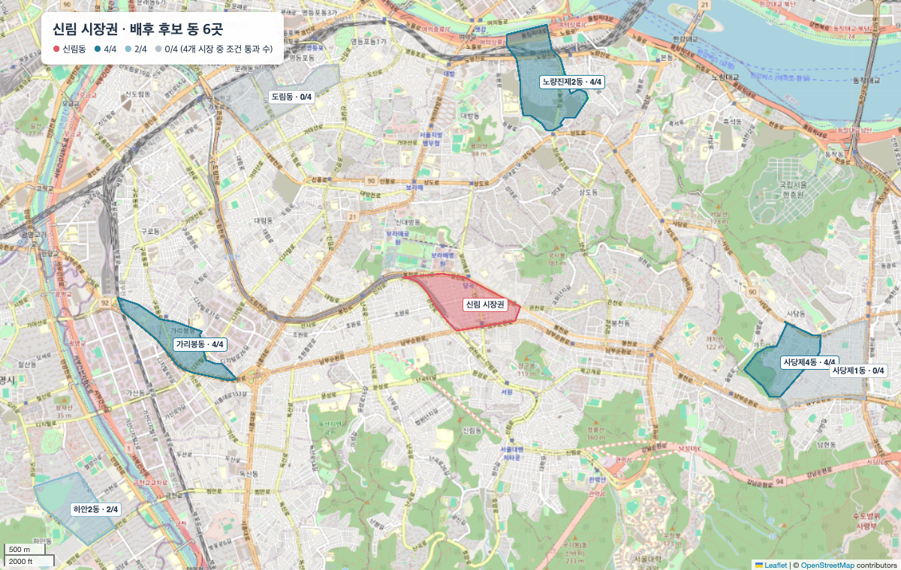

* **출발·배후:** 쇼핑 OD의 86.8%가 5km 안에서 출발, 가까운 주민 구성 유사 동 중 신림행 쇼핑 이동이 관측되지 않은 동도 확인
* **활성화 방안:** 평일 귀가 시간대 간편 먹거리·장보기 운영 검토, 가까운 배후 동을 대상으로 시장권 안내

비교 수치와 해석 범위

* **전국·유형 비교:** 귀가 목적 OD는 주거 귀가형 74.4%·전국 55.7%, 평일 20·30대 도착의 19~23시 비중은 전국 28.9%, 평일 20·30대 STAY의 같은 시간대 비중은 전국 시장 행 평균 31.0%
* **체류·출발 비교:** 전체 STAY 중 20·30대는 전국 26.3%, 쇼핑여가 목적 STAY는 신림 6.8%·전국 3.7%, 쇼핑 OD의 5km 안 출발은 전국 52.1%
* **해석 범위:** 야간 STAY는 신림 행정동의 시간별 체류 인원 합. 시장 안에서의 체류, 개인별 체류시간, 실제 구매는 확인되지 않음

### 쇼핑 밀집형 · 국제시장권

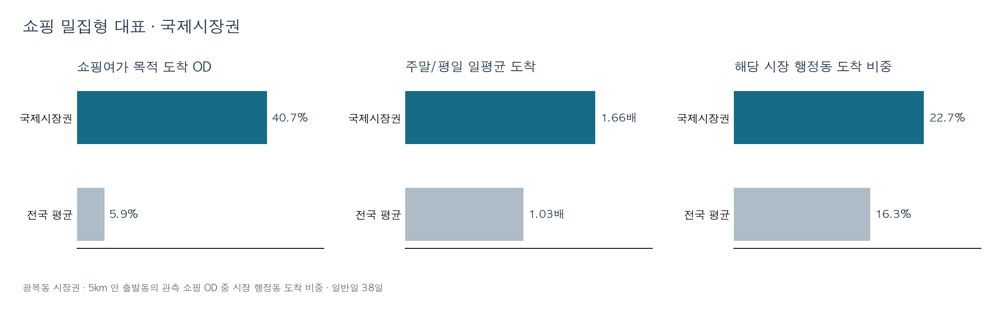

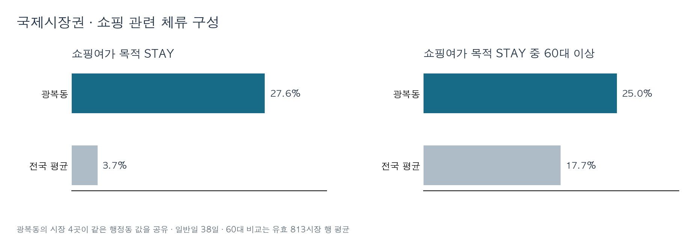

* **유입·체류:** 쇼핑여가 목적 OD 40.7%, STAY 27.6%. 쇼핑 OD 중 20대 26.3%, 쇼핑 STAY 중 60대 이상 25.0%로 연령 구성도 함께 확인

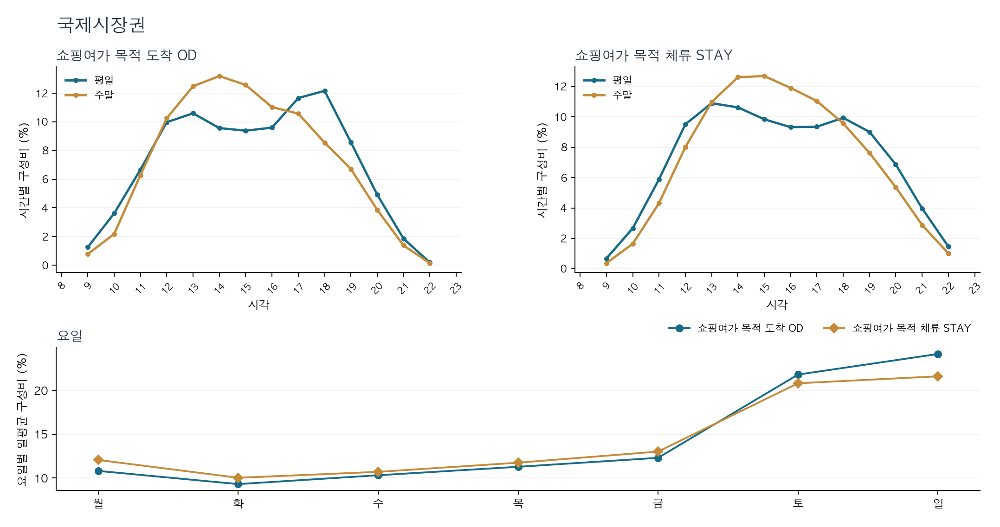

* **시간·요일:** 전 목적 도착 OD의 주말 일평균은 평일의 1.66배. 쇼핑 목적 OD·STAY도 토·일 일평균이 높고, 주말 시간별 정점은 각각 14시·15시

* **출발·주변 조건:** 쇼핑 OD의 40.5%가 2km 안에서 출발, 국제시장 반경 3km 안에 다른 등록 시장 22곳. 이 중 광복동 시장은 3곳, 다른 행정동 시장은 19곳
* **활성화 방안:** 광복동의 4개 시장을 우선 대상으로 공동 지도·쿠폰과 시장 간 동선 안내를 시범 검토

비교 수치와 해석 범위

* **전국 비교:** 쇼핑여가 목적 OD는 전국 5.9%, STAY는 전국 3.7%, 쇼핑 STAY 중 60대 이상은 유효 시장 행 전국 평균 17.7%, 반경 3km 안 다른 시장은 전국 평균 6.7곳
* **출발·요일:** 5km 안 출발동의 쇼핑 OD 중 광복동 도착 비중은 22.7%(전국 16.3%). 전 목적 OD의 주말/평일 일평균 비는 전국 1.03배, 쇼핑 OD의 주말 비중은 전국과 비슷해 주말 쇼핑 특유의 차이로 해석하지 않음
* **제안 범위:** 광복동 4개 시장의 쇼핑 신호와 밀집도를 근거로 한 시범 제안이며, 시장 간 연속 방문이나 쿠폰 효과는 확인되지 않음

* **시간·요일 그림:** 시간별 %는 평일·주말 각각의 관측 시간 합계 기준. 요일별 %는 각 요일의 일평균을 합쳐 100%로 환산한 값이며, 요일별 관측일 수는 4~6일로 다름. 중마의 OD는 귀가 목적, STAY는 전체 목적

## 적용 가능성

* **유형별 검토:** 같은 유형의 다른 시장에서는 해당 시장의 시간대·시설·상권 조건이 맞는지 먼저 확인한 뒤 시범 대상을 선정
* **시범 평가:** 운영 전후의 행정동 OD·STAY 자료만으로 시장 방문 효과를 판정하기 어려우므로, 시범 구역의 실제 방문·구매 기록과 운영 시간대 매출을 함께 수집

## 한계

* **관측 단위:** OD·STAY는 행정동 단위로 신림·국제시장권의 시장 4곳을 각각 구분하거나 실제 입장·구매를 확인할 수 없음.
* **유형 경계:** 
  * 5km Huff 기대점유가 없는 시장 121곳은 결측 표시와 중앙값 대입으로 처리. 
  * 대입 방식을 바꾸면 외곽형 수가 204곳에서 206곳으로 달라져 경계 시장의 유형은 신중히 해석해야 함.
* **관측 기간의 한계:** 분석에 사용한 날짜는 연휴·공휴일을 제외한 일반일 38일로 한정됨.

## 코드와 자료

* SKT 원자료와 결합된 시장 특성표는 제공받은 자료를 포함해 공개하지 않음. 유형 분류 노트북은 해당 비공개 특성표를 입력받으며, 공개 자료만으로 수치 전체를 재계산할 수는 없음

* 코드에는 공모전 수행 이후 보완한 분석이 포함되며 일부 외부 자료 경로에 2025년 날짜가 표기되어 있음. 실행 환경과 자료 범위는 [코드 안내](code/README.md) 참조.
